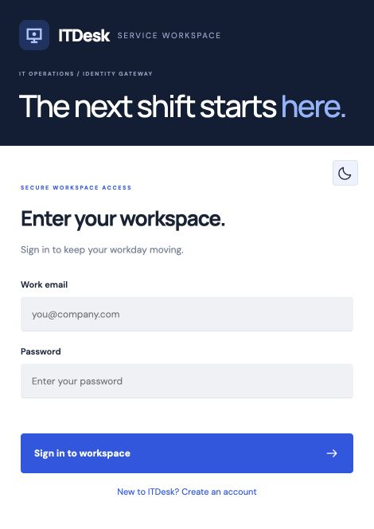
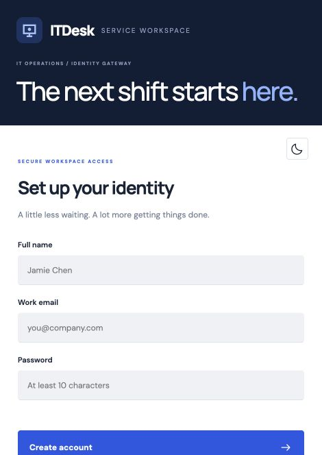
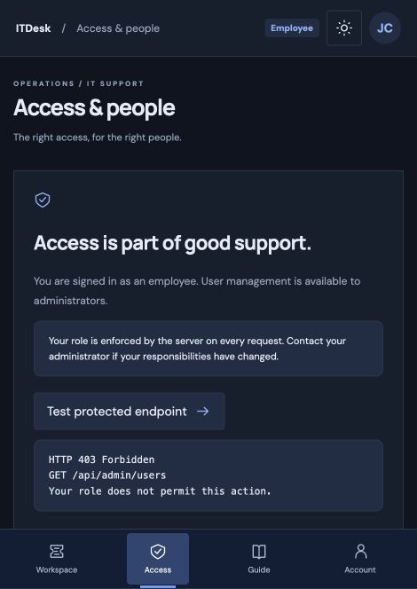

<div align="center">


# ITDesk

### Service operations, with a clear next move.

An IT support workspace for employees, support agents, and administrators. Built around real help-desk workflows and server-enforced role-based authorization.


**Week 6 · Task 3 — Role-Based Authorization**
</div>

[Live application](https://itdesk-rachit.onrender.com) · [GitHub repository](https://github.com/rachit1807/week6-task3-itdesk-rbac)

## Interface previews

| Sign in | Registration | Role protection |
|---|---|---|
|  |  |  |

## The problem

Internal IT teams need to receive requests, assign the right specialist, and protect employee information. ITDesk gives each role an appropriate workspace while checking permissions on the server for every protected request.

## Features

- Registration and sign-in with hashed passwords and expiring JWT sessions.
- Employee workspace: submit requests, view personal tickets, and join conversations.
- Support workspace: assigned tickets, status updates, priority changes, and comments.
- Administrator workspace: complete queue, ticket assignment, user roles, and activity log.
- Ticket categories, priorities, search, status filters, and CSV export.
- Responsive request cards and bottom navigation on mobile; a navigation bar and contextual brief on desktop.
- Persistent light/dark preference, keyboard-operable tickets, labeled forms, and native modal dialogs.
- SQLite for convenient local development; dedicated PostgreSQL for hosted persistence.

## Permission matrix

| Action                    | Employee (`user`) | Support agent (`agent`) | Administrator (`admin`) |
| ------------------------- | ----------------- | ----------------------- | ----------------------- |
| Submit a ticket           | Yes               | Yes                     | Yes                     |
| View and comment          | Own tickets       | Assigned tickets        | All tickets             |
| Update status / priority  | No                | Assigned tickets        | All tickets             |
| Assign a ticket           | No                | No                      | Yes                     |
| View users / change roles | No                | No                      | Yes                     |
| View audit log            | No                | No                      | Yes                     |

New registrations always receive the `user` role, even if a client submits a different role. A user cannot change their own role. Shared demo accounts are protected when `DEMO_MODE=true`.

## Run locally

Requires **Node.js 24+** and npm.

```sh
npm install
cp .env.example .env
npm run dev
```

Open **http://localhost:3000**. Local data is saved in `data/itdesk.db`; restarting the application preserves it. The directory and `.env` are excluded from Git. Open this folder in VS Code and use **Run and Debug → Launch ITDesk**, or run `npm run dev` in the integrated terminal.

### Demo accounts

| Role          | Email               | Password        |
| ------------- | ------------------- | --------------- |
| Administrator | `admin@itdesk.demo` | `DeskDemo!2026` |
| Support agent | `agent@itdesk.demo` | `DeskDemo!2026` |
| Employee      | `user@itdesk.demo`  | `DeskDemo!2026` |

The sign-in screen offers one-click demo entry. Demo data is seeded only into an empty database. Use fictional information in the shared demo.

## Authorization flow

1. Login verifies the bcrypt password hash and signs a JWT containing the user ID and role.
2. Authentication verifies the signature, HS256 algorithm, and two-hour expiry.
3. The current database role is checked so role changes affect existing sessions immediately.
4. `middleware/authorize.js` protects administrative routes; ticket routes also enforce ownership and assignment.
5. Missing or invalid authentication returns **401**. An authenticated account without permission receives **403**.

The browser uses an HttpOnly, SameSite cookie; production sets Secure. API clients can use the returned token as `Authorization: Bearer <token>`. Tokens are not stored in browser local storage. Login and registration are rate-limited; SQL queries use bound parameters; cross-origin browser mutations are rejected.

## API reference

| Method      | Endpoint                    | Purpose                                 |
| ----------- | --------------------------- | --------------------------------------- |
| GET         | `/api/health`               | Application and database readiness      |
| POST        | `/api/auth/register`        | Register an employee                    |
| POST        | `/api/auth/login`           | Sign in                                 |
| POST        | `/api/auth/logout`          | Clear browser session                   |
| GET         | `/api/auth/me`              | Current account                         |
| GET / POST  | `/api/tickets`              | List permitted tickets / create request |
| GET / PATCH | `/api/tickets/:id`          | Detail / update ticket                  |
| POST        | `/api/tickets/:id/comments` | Add a comment                           |
| GET         | `/api/admin/users`          | List accounts                           |
| PATCH       | `/api/admin/users/:id/role` | Change another user's role              |
| GET         | `/api/admin/audit`          | Recent administrative and ticket events |

### Example request

```json
{
  "title": "Cannot connect to the office VPN",
  "description": "The VPN disconnects repeatedly during client calls.",
  "category": "Network",
  "priority": "high"
}
```

Categories: Hardware, Software, Network, Access, Other. Priorities: low, medium, high, urgent. Statuses: open, in-progress, resolved, closed.

## Verify access control

```sh
npm test
```

Tests use a fresh in-memory SQLite database and cover successful admin access, employee/agent denial, missing/forged/expired tokens, registration privilege escalation, ownership checks, assignment, comments, validation, stored role changes, and cross-site request rejection.

Import `postman/collection.json` into Postman. Run the three sign-in requests first; they save role tokens automatically. Subsequent requests assert the expected 200, 201, 401, or 403 status. Change the `baseUrl` collection variable to test a deployed instance. Seed-dependent examples assume the sample records have not been reassigned.

## Configuration

| Variable        | Purpose                                                                    |
| --------------- | -------------------------------------------------------------------------- |
| `PORT`          | HTTP port; defaults to 3000                                                |
| `JWT_SECRET`    | At least 32 random characters; required in production                      |
| `NODE_ENV`      | Set to `production` on the live service                                    |
| `DATABASE_URL`  | Dedicated PostgreSQL TLS connection URL; when absent, local SQLite is used |
| `DATABASE_PATH` | SQLite file path; defaults to `./data/itdesk.db`                           |
| `DEMO_MODE`     | Set `true` to seed an empty hosted demo and protect demo roles             |

Use a direct PostgreSQL endpoint with TLS. Hosted data belongs in a dedicated database, with all application tables in the `itdesk` schema. Do not reuse credentials from another project. The application pool is limited to three connections.

## Deployment

The live application uses a dedicated Neon project **ITDesk** in Singapore, PostgreSQL 18, with a production branch whose expiry is set to **Never**. Existing project databases are not reused.

Deploy the Node service with `npm ci` as the build command, `npm start` as the start command, and `/api/health` as its health check. Configure a dedicated Neon PostgreSQL production database and supply `DATABASE_URL` securely. Generate a strong `JWT_SECRET` and set `NODE_ENV=production` and `DEMO_MODE=true` for the portfolio demo.

A persistent external database keeps records across Render restarts and redeployments. Do not rely on SQLite files on a free service's ephemeral filesystem. Use a database branch with no scheduled expiry; provider storage, compute, transfer, and recovery limits still apply. Keep independent backups.

## Project structure

```text
middleware/authorize.js       Role checks
models/User.js               Roles and safe user serialization
routes/adminRoutes.js        Protected people and audit routes
src/app.js                   Authentication and ticket APIs
src/db.js                    Local schema and sample data
src/postgres.js              Hosted PostgreSQL storage
src/server.js                Startup and shutdown
public/                     Responsive interface and assets
tests/authorization.test.js  Access-control verification
postman/collection.json      Role-based API requests
.vscode/launch.json          VS Code launch configuration
```

## Scope and operational notes

ITDesk is an educational portfolio application with a shared demo. It does not include email delivery, file attachments, SSO, password recovery, or production monitoring. Logout removes the browser cookie; a separately copied bearer token remains valid until expiry. Take backups and apply an organization-specific security review before using real business records.

---

Created by **Rachit Tripathi**.
